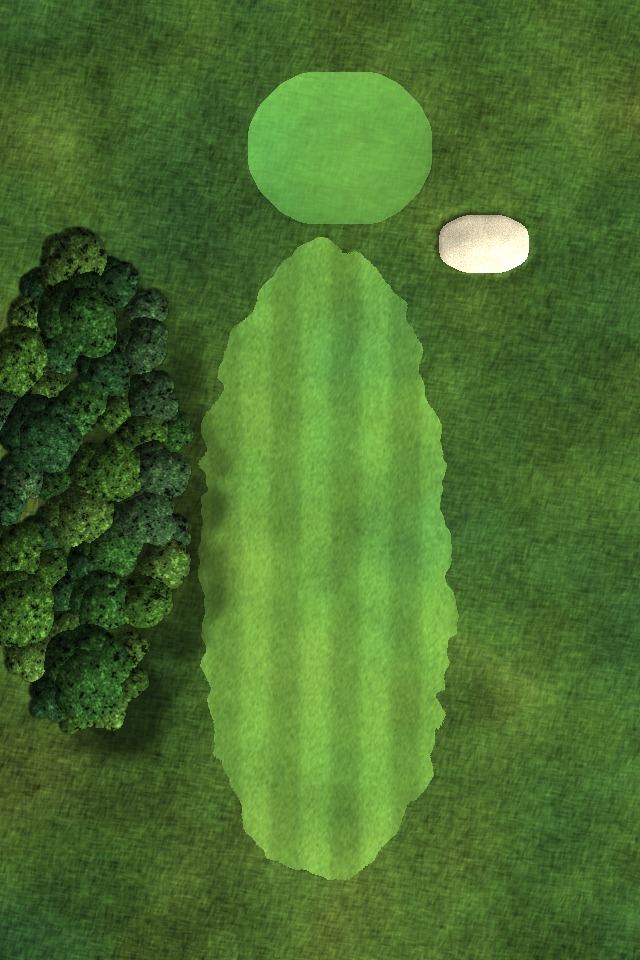
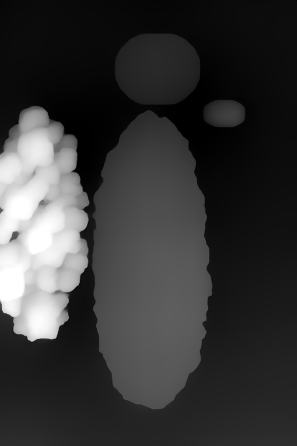
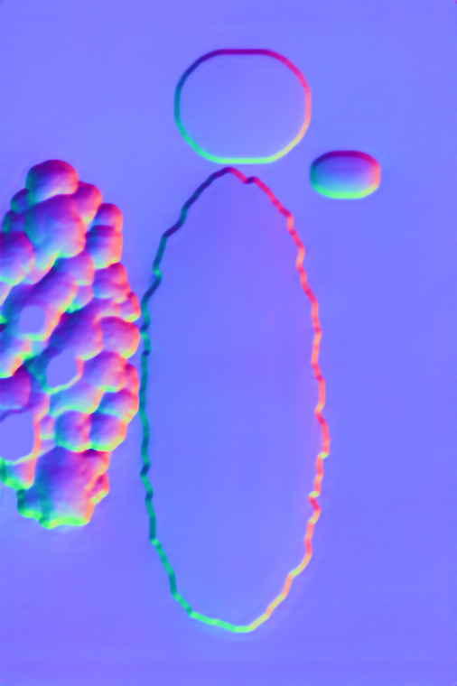
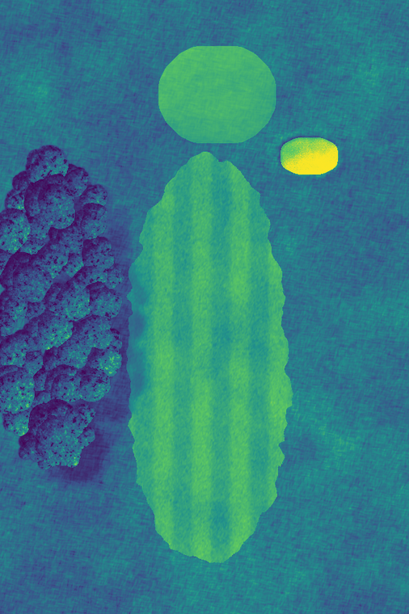
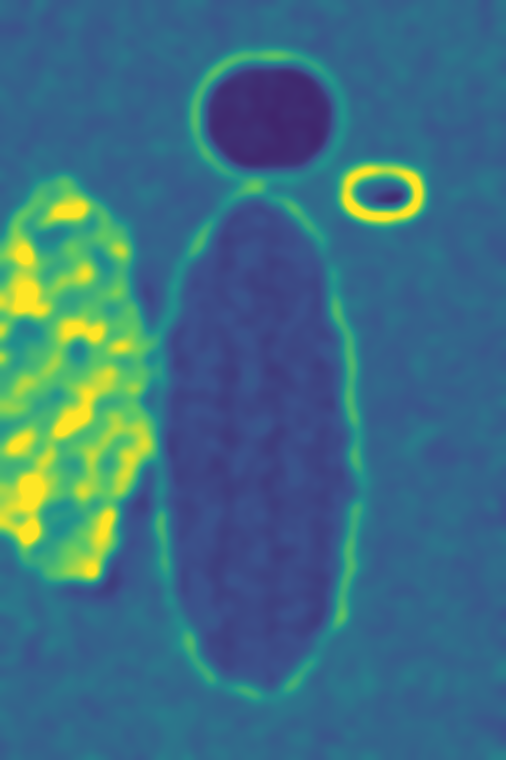

# imagin

1枚の画像から、バンプマップ・高さマップ・法線マップ・ヒートマップなどの分析用マップを作り、絵柄を数値で測るツール群です。2Dの手続き型シェーダー（芝、砂、樹冠、陰影）も入っています。

| 生成した例（`shaders/demo.py`） | 高さマップ | 法線マップ | 明るさのヒートマップ | 描き込みのヒートマップ |
|---|---|---|---|---|
|  |  |  |  |  |

## 構成

| ディレクトリ | 中身 |
|---|---|
| `maps/maps.py` | 1枚の画像から高さマップ（Depth Anything V2）、法線マップ、バンプマップ、輝度から作るバンプマップ、明るさと描き込み量のヒートマップ、パレットを出力します |
| `shaders/shaders.py` | 2Dの手続き型シェーダーです。fBmノイズ、草の葉の向きを表すノイズ（blades）、ドメインワープ、ラベル画像を輪郭なめらかに拡大する処理、高さから法線を作る処理、Lambert陰影と陰影図（hillshade）、芝刈りの縞、色相のゆらぎ、芝・砂・樹冠の質感、投影される影 |
| `shaders/demo.py` | 上のシェーダーを使って小さなゴルフホールを描画するデモです（`examples/shader_demo*.png`） |
| `analysis/` | 絵柄の計測ツール一式です（`stylemetrics.py` に全指標をまとめてあります）。詳しくは下の表 |
| `research/` | `stylemetrics.py` にまとめる前の実験スクリプトです（深度の帯ごとの比較、エッジ、metrics2〜5）。参照画像のパスは `./data/refs` に置き換えてあります |
| `docs/` | 理論（`style-theory.md`）、目標スタイルの数値表、研究ノート（`knowledge.md`：PBRシェーダーのマップ一覧、ディスプレイスメント、2Dコンポジット、ポストエフェクトなど） |
| `examples/` | 出力例です。`encodings/` には ChatGPT に渡したスタイル指定（0〜1のパラメータ、数式、ヒートマップ）と、群ごとのレシピが入っています |

### `analysis/` の計測項目

| スクリプト | 測るもの |
|---|---|
| `stylemetrics.py` | 深度の帯（空・遠景・中景・手前）ごとの明るさとコントラスト、エッジ、明暗の分布（ノタン）、彩度、色温度、周波数帯ごとの描き込み量、線、タッチ、陰影の段数、ライティング、形状（法線のばらつき、光源の推定、bump） |
| `measure.py IMAGE [--panels]` | 目標スタイル（昼）の範囲に、何項目入っているかを判定します |
| `pbr.py` | 1枚の2D画像から、PBRマップに相当する値（アルベドと陰影の比率、ラフネス、スペキュラ、AO、SSSなど）を推定します |
| `comp.py` | 構図を測ります（透視線、消失点、明暗の境目にできる色の帯） |
| `composite.py` / `composite2.py` | 深度を使った2Dの後処理（S字カーブ、ビネット、縁の光の抑制）を、目標の指標に近づくよう自動で最適化します |
| `upscale.py` | Real-ESRGAN（spandrel）で高解像度化します |

## 使い方

```bash
python -m venv .venv && . .venv/bin/activate
pip install -r requirements.txt

python maps/maps.py photo.jpg out/            # 深度推定あり（初回はモデルをダウンロード）
python maps/maps.py photo.jpg out/ --no-depth # 輝度から作るマップだけ
python shaders/demo.py
cd analysis && python measure.py ../photo.jpg
```

```python
import sys; sys.path.insert(0, "shaders")
import shaders as sh
h = sh.fbm((512, 512), 200, seed=1)
normal_rgb = sh.normal_map_rgb(sh.height_to_normal(h, 4))
shade = sh.hillshade(h * 18)
```

## メモ

- 1枚の画像からの推定なので限界があります。光源の仰角、ランプ、AOは信頼できません。メタリック、クリアコート、異方性は2D画像からは推定できません。
- ドメインワープを細かいスケール（8px程度）でかけると、輪郭が虫食いのようになって領域の区別が消えます。大きなスケールだけで使ってください。
- 分析用のマップ（高さ、法線、バンプ）はローカルでの計測と描画に使うためのものです。画像生成AIには、描画結果か、文章・パラメータに直した形で渡しています。
- 使用例: [golf-course-photoreal](https://github.com/net-runners-com/golf-course-photoreal)（コースのレイアウト図 → 白黒マスク → 高さとバンプで陰影 → 写真調）
- `examples/target-clusters.jpg` と `examples/normal-height-sheet.jpg` には、計測に使った外部の参照画像の縮小版が含まれています。
